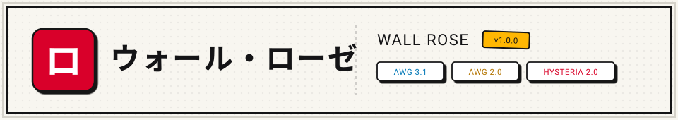
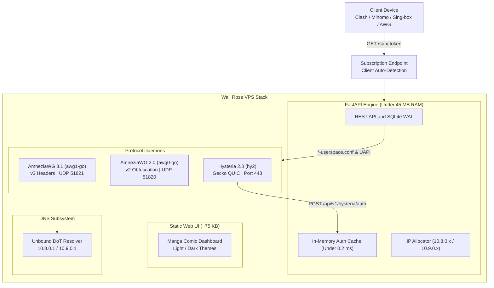

<p align="center">
  
</p>

<h1 align="center">ウォール・ローゼ</h1>

<p align="center">
  <a href="#license"></a>
  <a href="#release"></a>
</p>

---

## Overview

Wall Rose (`ウォール・ローゼ`) is a lightweight personal multi-protocol VPN gateway and management dashboard designed for hostile network environments with aggressive Deep Packet Inspection (DPI) and protocol throttling.

The backend is built with FastAPI and SQLite WAL, maintaining an idle memory footprint under 45 MB of RAM.

### Protocols

- **AmneziaWG 3.1:** Userspace `amneziawg-go` daemon (`awg1-go`) with version 3 header protection (`header-protection-key`) and randomized packet padding.
- **AmneziaWG 2.0:** Userspace `amneziawg-go` daemon (`awg0-go`) with version 2 junk packet obfuscation for hardware routers and legacy clients.
- **Hysteria 2.0:** QUIC-based transport on port 443 with Gecko packet fragmentation obfuscation (`obfs: gecko`, `512:1200`) for high-loss cellular connections.

---

## Architecture



---

## Installation

Deploy on a fresh Ubuntu or Debian server with a single command:

```bash
curl -fsSL https://raw.githubusercontent.com/h1am7a/wall-rose/main/install.sh | sudo bash
```

Custom port and master password overrides are supported via environment variables:

```bash
PORT=8080 ADMIN_PASSWORD="your_secret_password" curl -fsSL https://raw.githubusercontent.com/h1am7a/wall-rose/main/install.sh | sudo -E bash
```

The installer automatically configures:
- BBR congestion control and UDP buffer tuning (`/etc/sysctl.d/99-wallrose.conf`).
- AmneziaWG userspace engine (`amneziawg-go`), interface configs (`awg0`, `awg1`), and randomized obfuscation keys.
- Hysteria 2.0 daemon on single UDP port 443 and RSA-2048 self-signed certificates.
- Local Unbound DNS-over-TLS resolver on `10.8.0.1:53` and `10.9.0.1:53`.
- `iptables` NAT masquerading and MSS clamping.
- 16-character CSPRNG master password stored in `/opt/wallrose/backend/.env` (`chmod 600`).
- Systemd service units (`awg0-go.service`, `awg1-go.service`, `wallrose-panel.service`, `hysteria-server.service`).

---

## Client Setup

### Mihomo / Clash Verge Rev / Flclash
1. Open dashboard, unlock console, and click **Mihomo Sub** on the device card.
2. In the client, add subscription via URL: `http://<SERVER_IP>:8000/sub/<TOKEN>`
3. Set update interval to 24 hours.

Configurations follow the Trinity split-routing standard with `AUTO-FAILOVER` (fallback interval 60s, timeout 5s, active probe) and `TRINITY` (manual selector), routing Russian domestic services directly (`category-ru`, `gov.ru`, `geoip-ru`) and all blocked/international traffic through the VPN mesh.

### Sing-box (iOS, Android, macOS, Linux)
1. Click **Sing-box** on the device card.
2. Add remote profile with URL: `http://<SERVER_IP>:8000/sub/<TOKEN>?format=json`

### Official AmneziaWG Client
1. Click **AWG .conf** on the device card.
2. Select **AWG 3.1** (anti-DPI) or **AWG 2.0** (standard) and download configuration.

---

## REST API Reference

Interactive OpenAPI documentation is available at `/docs` (Swagger) and `/redoc` (ReDoc).

| Endpoint | Method | Description |
| :--- | :--- | :--- |
| `/api/auth/login` | `POST` | Authenticate master administrator; sets HttpOnly session cookie |
| `/api/auth/logout` | `POST` | Invalidate active session and clear cookie |
| `/api/auth/status` | `GET` | Verify current session health |
| `/api/peers` | `GET`, `POST` | List registered peers; enroll new device with live kernel mutation |
| `/api/peers/{id}` | `GET`, `PUT`, `DELETE` | Peer details, name updates, credential revocation |
| `/api/peers/{id}/status` | `PATCH` | Toggle peer active/suspended state in kernel live |
| `/api/peers/{id}/awg.conf` | `GET` | Export AmneziaWG configuration file |
| `/api/cores` | `GET` | Protocol daemon statuses (`awg0`, `awg1`, `hy2`) |
| `/api/cores/{id}/config` | `GET`, `PUT` | Read or update protocol configuration |
| `/api/cores/{id}/restart` | `POST` | Restart daemon systemd unit |
| `/api/telemetry` | `GET` | Host CPU, RAM, network bandwidth, active peer counters |
| `/sub/{token}` | `GET` | Subscription delivery with User-Agent client auto-detection |
| `/api/backup/export` | `GET` | Download database snapshot archive (`.tar.gz`) |
| `/api/backup/restore` | `POST` | Restore database with traversal validation |

---

## Development & Testing

```bash
# Clone and enter directory
git clone https://github.com/h1am7a/wall-rose.git
cd wall-rose/vpn-panel

# Virtual environment setup
python3 -m venv venv
source venv/bin/activate  # Windows: .\venv\Scripts\Activate.ps1
pip install -r backend/requirements.txt

# Run full test suite (23 tests: units, API contracts, resilience, stress)
pytest backend/tests -v

# Start local server
cd backend
uvicorn app.main:app --host 0.0.0.0 --port 8000 --reload
```

---

## Security

- **Zero-Trust Administrative Gate:** All data and configuration APIs require session authorization. Unauthenticated calls return `401 Unauthorized`.
- **Anti-Bruteforce Lockout:** Exceeding 5 failed login attempts activates an immediate 5-minute IP lockout (`429 Too Many Requests`).
- **HttpOnly Session Cookies:** Session tokens are stored in `HttpOnly`, `SameSite=Lax` cookies, preventing client-side script theft.
- **Direct Subprocess Execution:** System commands execute strictly via argument arrays (`shell=False`).
- **Path Traversal Protection:** Backup archives are validated using `os.path.commonpath()` and Python 3.12 `filter="data"`.
- **Query Parameterization:** SQLite queries run exclusively through SQLAlchemy 2.0 async ORM.
- **High-Entropy Tokens:** Subscription tokens are generated via `secrets.token_urlsafe(32)` (256-bit CSPRNG entropy).
- **Subnet Isolation:** Forwarding rules isolate client subnets (`10.8.0.0/24`, `10.9.0.0/24`) to prevent peer traversal.
- **Loopback Internal Protection:** Internal Hysteria authentication callbacks reject external traffic.

---

## License

MIT License. See [LICENSE](LICENSE) for details.
