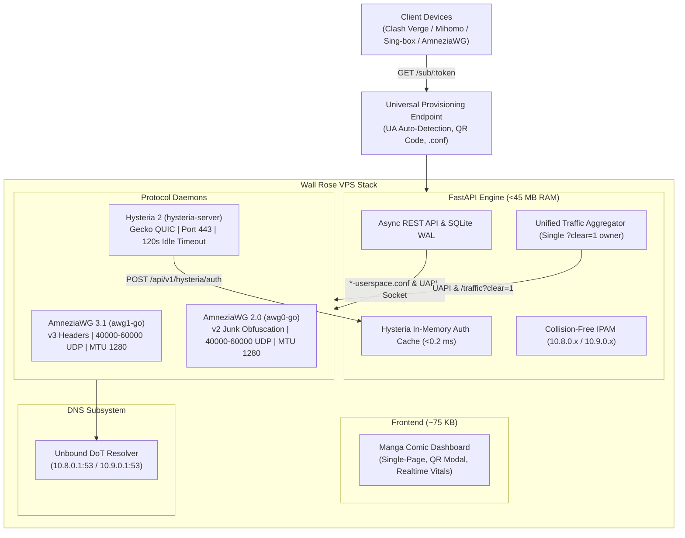

<p align="center">
  
</p>

<h1 align="center">ウォール・ローゼ (Wall Rose)</h1>

<p align="center">
  <a href="#license"></a>
  <a href="#release"></a>
  <a href="#tests"></a>
</p>

---

## Overview

**Wall Rose (ウォール・ローゼ)** is an ultra-lightweight, zero-bloat personal multi-protocol VPN gateway and responsive web dashboard engineered specifically for hostile network conditions characterized by aggressive Deep Packet Inspection (DPI), SNI-blocking, and UDP throttling. The stack combines **AmneziaWG 3.1** (anti-DPI userspace wireguard with header protection and dynamic trailers), **AmneziaWG 2.0** (junk-packet obfuscation for legacy and hardware routers), and **Hysteria 2.13+** (QUIC transport over UDP port 443 with Gecko DPI fragmentation). Built with pure Python 3.11+, FastAPI, and SQLite WAL, the backend operates with an idle footprint under **45 MB RAM**.

---

## Architecture



---

## Clean Installation (Single-Command)

> [!IMPORTANT]
> Wall Rose installer performs a **clean installation only**. It never parses or preserves old configuration files (`awg*-userspace.conf`, `config.yaml`). Each installation generates fresh, cryptographically randomized keys, collision-free junk/header parameters, and dynamic non-standard UDP ports.

### Minimum System Requirements
- **OS:** Ubuntu 22.04 LTS, Ubuntu 24.04 LTS, or Debian 12 (x86_64 or aarch64)
- **RAM:** Minimum 512 MB (panel + all 3 daemons consume < 110 MB combined)
- **Privileges:** Root access (`sudo -i`)

### Run Installer

```bash
curl -fsSL https://raw.githubusercontent.com/h1am7a/wall-rose/main/install.sh | sudo bash
```

### Environment Variable Overrides

```bash
# Example 1: Custom port and admin password
PORT=8000 ADMIN_PASSWORD="your_custom_password" curl -fsSL https://raw.githubusercontent.com/h1am7a/wall-rose/main/install.sh | sudo -E bash

# Example 2: Bind panel to loopback only (127.0.0.1) for reverse proxy or SSH tunnel access
HOST=127.0.0.1 curl -fsSL https://raw.githubusercontent.com/h1am7a/wall-rose/main/install.sh | sudo -E bash

# Example 3: Explicit public IP override for client subscriptions (e.g. cloud /32 alias)
SERVER_PUBLIC_IP=198.51.100.2 bash install.sh
```

| Variable | Default | Description |
|---|---|---|
| `HOST` / `PANEL_HOST` | `0.0.0.0` | Bind address for web panel (`0.0.0.0` for all interfaces or `127.0.0.1` for loopback-only) |
| `PORT` | `8000` | HTTP port for web panel dashboard |
| `SERVER_PUBLIC_IP` | Auto-detected | Public IPv4 address used in client subscription configurations and TLS certificates |
| `ADMIN_PASSWORD` | Random 16-char | Master administrator password |

### Automated Setup Actions
1. **Kernel & Network Optimization:** Enables BBR congestion control, sets TCP window scaling, and tunes UDP buffers (`/etc/sysctl.d/99-wallrose.conf`).
2. **Dynamic UDP Ports:** Randomly picks two unique, free ports strictly in the `40000..60000` range via `socket.bind()` for `awg0` and `awg1` (bypassing ISP default port throttling).
3. **AmneziaWG Userspace Engine:** Installs `amneziawg-go`, generates x25519 keypairs, collision-free packet sizes ($148+S_1 \neq 92+S_2 \neq 64+S_3 \neq 32+S_4$), and $J_c \in [4..12]$.
4. **Hysteria 2 Daemon:** Configures Gecko obfuscation on UDP port 443 with `maxIdleTimeout: 120s` and `ignoreClientBandwidth: true`.
5. **DNS Subsystem:** Deploys local Unbound DoT resolver on `10.8.0.1` and `10.9.0.1`.
6. **Firewall & Masquerading:** Configures `iptables` NAT masquerading and TCP MSS clamping (1240 bytes).
7. **Systemd Units:** Enables and starts `awg0-go`, `awg1-go`, `hysteria-server`, and `wallrose-panel`.
8. **Master Credentials:** Stores credentials in `<INSTALL_DIR>/backend/.env` and `/root/wallrose_credentials.txt` (`chmod 600`).

---

## Configuration Standards

| Parameter | Recommended Value | Description |
| :--- | :--- | :--- |
| **AWG UDP Ports** | `40000..60000` | Randomly selected via `socket.bind()`, collision-free between awg0/awg1 |
| **AWG MTU** | `1280` | Minimum IPv6/wireguard MTU to guarantee zero packet fragmentation under DPI |
| **AWG Jc (Junk Packets)** | `4..12` | AmneziaWG recommended count (1-3 is classified too quickly by TSPU) |
| **AWG S1..S4 Sums** | Collision-free | $148+S_1$, $92+S_2$, $64+S_3$, $32+S_4$ all unique to prevent handshake stalls |
| **AWG 3.1 Stealth Params** | Complete 8-param set | HeaderProtectionKey, ContentPaddingAddition, RekeyAfterTime, RekeyTimeout, RejectAfterTime, KeepaliveTimeout, MaxHandshakeAttempts, RandomTrailers, DisableCookies |
| **Hysteria Listen Port** | `443` | Standard HTTPS QUIC port for camouflage |
| **Hysteria maxIdleTimeout** | `120s` | Maximum allowed by Hysteria v2.13.0 (higher causes daemon fatal crash) |
| **Hysteria ignoreClientBandwidth**| `true` | Prevents client-side speed limits from throttling server throughput |
| **Mihomo Failover Interval**| `30s` | Health check interval |
| **Mihomo Failover Timeout** | `3000ms` | Failure detection timeout |
| **Mihomo Failover Retries** | `2` | Max failed attempts before switching protocol |
| **Mihomo Failover Probe** | `https://www.gstatic.com/generate_204` | Lightweight reliable probe URL |

---

## Client Provisioning & Usage

### 1. Mihomo / Clash Verge Rev / Flclash
- In dashboard, click **Sub URL** (or scan **QR Code**).
- Import subscription URL: `http://<SERVER_IP>:8000/sub/<TOKEN>`.
- Client receives Trinity full-tunnel configuration:
  - `GLOBAL` (default-selected: `TRINITY`)
  - `TRINITY` (default-selected: `AUTO-FAILOVER`)
  - `AUTO-FAILOVER` (active fallback among AWG1-v3, AWG0-v2, and Hy2-gecko)
  - Strict local `DIRECT` rules for loopback (127.0.0.0/8), LAN (10.0.0.0/8, 172.16.0.0/12, 192.168.0.0/16), link-local (169.254.0.0/16), and fake-IP (198.18.0.0/15) to prevent client TUN routing loops. All internet traffic routes via `MATCH,TRINITY`.

### 2. Sing-box (iOS, Android, macOS, Linux)
- Click **Sing-box** on the device card.
- Import remote profile URL: `http://<SERVER_IP>:8000/sub/<TOKEN>?format=json`.

### 3. Official AmneziaWG / WireGuard Client
- Click **AWG .conf** on the device card.
- Select **AWG 3.1** (anti-DPI with Header Protection) or **AWG 2.0** (standard junk obfuscation).
- Click **Download .conf File** or copy text directly.

---

## REST API Reference

Interactive OpenAPI documentation is live at `/docs` (Swagger UI) and `/redoc` (ReDoc).

| Method | Path | Auth Required | Description | Example Response |
| :--- | :--- | :--- | :--- | :--- |
| `POST` | `/api/auth/login` | No | Master password authentication, sets `admin_session` cookie | `{"ok": true, "token": "wr_sess_..."}` |
| `POST` | `/api/auth/logout` | No | Invalidate session token and clear session cookie | `{"ok": true, "message": "Logged out"}` |
| `GET` | `/api/auth/status` | No | Health check for active administrative session | `{"authenticated": true}` |
| `GET` | `/api/peers` | Admin | List all registered devices with live bandwidth and handshake | `[{"id": 1, "name": "Phone", "is_online": true, ...}]` |
| `POST` | `/api/peers` | Admin | Enroll new device (allocates IPs, keypairs, live kernel register) | `{"id": 2, "name": "Laptop", "token": "..."}` |
| `GET` | `/api/peers/{id}` | Admin | Get full technical device credentials and raw keys | `{"id": 1, "awg1_pubkey": "...", "awg1_psk": "..."}` |
| `PUT` | `/api/peers/{id}` | Admin | Update device name and platform description | `{"id": 1, "name": "Phone_v2"}` |
| `PATCH`| `/api/peers/{id}/status` | Admin | Transition state (`ACTIVE` $\leftrightarrow$ `SUSPENDED`) live in kernel | `{"id": 1, "status": "SUSPENDED"}` |
| `DELETE`| `/api/peers/{id}` | Admin | Revoke keys, unregister from kernel, release IP addresses | `{"ok": true, "message": "Device revoked"}` |
| `GET` | `/api/peers/{id}/awg.conf` | Admin | Generate ready-to-import `.conf` (version `3.1` or `2.0`) | `[Interface]\nAddress = 10.9.0.2/32...` |
| `GET` | `/api/cores` | Admin | Operational health and listening ports of all 3 daemons | `[{"core_id": "awg1", "is_active": true, ...}]` |
| `GET` | `/api/cores/{id}/config` | Admin | Fetch raw daemon configuration file from disk | `{"core_id": "awg1", "content": "..."}` |
| `PUT` | `/api/cores/{id}/config` | Admin | Update raw daemon configuration file | `{"ok": true, "message": "Configuration saved"}` |
| `POST` | `/api/cores/{id}/restart` | Admin | Gracefully restart daemon via systemd | `{"ok": true, "message": "awg1 restarted"}` |
| `GET` | `/api/telemetry` | Admin | Real-time CPU, RAM, network throughput, connected peers | `{"cpu_percent": 3.2, "ram_percent": 14.1, ...}` |
| `GET` | `/api/audit/logs` | Admin | Query administrative audit trail (action/status filters, pagination) | `{"ok": true, "total": 42, "items": [...]}` |
| `GET` | `/api/system/logs` | Admin | Query sanitized journalctl logs (`panel`, `hy2`, `awg0`, `awg1`) | `{"ok": true, "service": "panel", "logs": [...]}` |
| `POST` | `/api/v1/hysteria/auth` | Internal | High-speed HTTP auth callback for Hysteria daemon (<0.2 ms) | `{"ok": true, "id": "user_4a"}` |
| `POST` | `/api/v1/hysteria/sync-traffic` | Admin | Trigger unified traffic aggregator pass (single `?clear=1` owner) | `{"ok": true, "message": "Aggregated..."}` |
| `GET` | `/sub/{token}` | Public | Smart subscription (User-Agent detection: YAML, JSON, HTML) | YAML or JSON configuration profile |
| `GET` | `/api/backup/export` | Admin | Consistent SQLite WAL checkpoint (`VACUUM INTO`) `.tar.gz` export | Binary archive attachment |
| `POST` | `/api/backup/restore` | Admin | Validate path traversal and restore system database | `{"ok": true, "message": "Restored"}` |

---

## Security & Zero-Logs Privacy Policy

- **Zero-Logs Traffic Policy:** Wall Rose does not log, inspect, store, or forward user browsing history, destination IPs, DNS queries, or transmitted payload data. Unbound DoT and protocol daemons run with minimal logging.
- **Uvicorn `--no-access-log` Hardening:** The panel web daemon runs with `--no-access-log` under systemd. Subscription access tokens (`/sub/<token>`) are never logged in plaintext access logs or journald buffers.
- **Journald Strict Retention Limits:** Host journald limits are strictly capped (`SystemMaxUse=50M`, `RuntimeMaxUse=20M`) to prevent disk bloat and forensic persistence.
- **Live In-Memory Sanitization:** The `/api/system/logs` endpoint passes all journal entries through regex sanitizers that redact `PrivateKey`, `PresharedKey`, `HeaderProtectionKey`, `hy2_pass`, bearer tokens, and `/sub/<token>` paths before delivery to the browser.
- **SQLite Ring-Buffer Pruning:** The administrative audit trail is bounded to a maximum of 1,000 events with automatic FIFO pruning.
- **Timing-Attack Immune Authentication:** Master password verification executes via `hmac.compare_digest()` constant-time comparison in `app/security.py`.
- **Anti-Bruteforce Lockout:** More than 5 failed authentication attempts within 5 minutes results in immediate HTTP 429 lockout per client IP.
- **HttpOnly & Secure Session Isolation:** Session tokens are delivered via `HttpOnly`, `SameSite=Lax` cookies with `wr_sess_` high-entropy random identifiers.
- **Single Owner of Hysteria Traffic Counter:** Exactly one reader processes `/traffic?clear=1` under `get_aggregator_lock()`, eliminating delta counter loss.
- **Path Traversal & Archive Bomb Defense:** Backup restoration validates normalized paths, rejects `..` components, absolute paths, and limits archive size to 50 MB (`HTTP 413 Content Too Large`).
- **Unicode Content-Disposition:** Client subscription and `.conf` file headers follow RFC 5987 / RFC 6266 with URL-encoding, preventing Latin-1 encoding crashes on Russian/Unicode device names.
- **CSPRNG Entropy:** All WireGuard keys, PSKs, HeaderProtectionKeys, Gecko passwords, and master credentials are generated via Python `secrets`. Zero hardcoded credentials exist in source code.

---

## Troubleshooting

### 1. `awg-go-service` IPC error: -22 (Invalid argument)
**Cause:** Passing WireGuard interface parameters (`Address`, `MTU`, `DNS`) directly to `awg setconf`. Userspace `amneziawg-go` only accepts `ListenPort`, `PrivateKey`, and obfuscation tags in `setconf`.
**Fix:** The installer strips `Address|MTU|DNS` before invoking `awg setconf`. Network addresses are assigned via `ip address add`.

### 2. Handshake active, but internet traffic stalls (HTTP 504 / timeout)
**Cause:** S-parameter collisions ($148+S_1 = 92+S_2$) or $J_c < 4$ flagged by ISP DPI filters.
**Fix:** Verify $J_c \in [4..12]$ and unique packet lengths. In the panel, check that device MTU is set to 1280.

### 3. Changes to `.py` files not visible on live server
**Fix:** Restart panel systemd service:
```bash
sudo systemctl restart wallrose-panel.service
```

### 4. Viewing real-time service logs
```bash
# Panel logs
sudo journalctl -u wallrose-panel.service -f

# AmneziaWG 3.1 daemon
sudo journalctl -u awg1-go.service -f

# Hysteria 2 daemon
sudo journalctl -u hysteria-server.service -f
```

---

## Local Development & Testing

```bash
# Clone repository
git clone https://github.com/h1am7a/wall-rose.git
cd wall-rose/vpn-panel/backend

# Create virtual environment
python3 -m venv venv
source venv/bin/activate  # On Windows: .\venv\Scripts\Activate.ps1
pip install -r requirements.txt

# Run complete test suite (56 comprehensive tests)
# Linux / macOS:
PYTHONPATH=. pytest tests/ -v
# Windows PowerShell:
$env:PYTHONPATH="."; pytest tests/ -v

# Run local development server
uvicorn app.main:app --host 0.0.0.0 --port 8000 --reload
```

---

## License

MIT License. See [LICENSE](LICENSE) for details.
